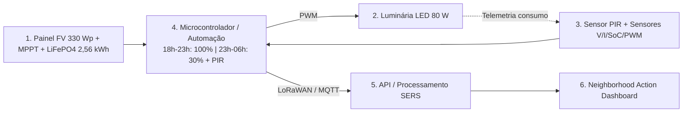

# Neighborhood Action Dashboard — Módulo SERS (Praça Comunitária Sustentável)

> **Disciplina:** Soluções em Energias Renováveis e Sustentáveis (SERS)  
> **Curso:** Ciência da Computação — Turma **1CCPA** (FIAP)  
> **Desafio Integrador:** Global Solution 2026.2 (`CitizenTech`)

## Integrantes do Grupo

* **Thalles Passos da Cunha** — RM `574879` (1CCPA)
* **Waldir Arthur Holanda de Sousa** — RM `576869` (1CCPA)

---

## Visão Geral do Projeto

Este repositório reúne a contribuição da disciplina **Soluções em Energias Renováveis e Sustentáveis (SERS)** ao projeto integrador **Neighborhood Action Dashboard (`CitizenTech`)**.

* **Espaço comunitário analisado:** Praça comunitária urbana com **10 postes de iluminação pública**.
* **Problema energético:** Luminárias convencionais de **vapor de sódio de 250 W** ligadas continuamente por **12 horas/noite** (18h00 às 06h00), sem dimerização ou monitoramento — consumindo **900 kWh/mês** (**R$ 765,00/mês** a R$ 0,85/kWh) e desperdiçando energia durante a madrugada de baixo fluxo (23h00 às 06h00).
* **Solução proposta (Alternativa B):** Substituição por **10 luminárias solares fotovoltaicas autônomas (*off-grid*) de 80 W** com **módulo FV de 330 Wp**, **banco de baterias $\text{LiFePO}_4$ ($25,6\text{ V} / 100\text{ Ah} = 2,56\text{ kWh}$, autonomia real de 3,09 dias a DoD 80%)**, **dimerização inteligente via sensor PIR** (100% das 18h às 23h; 30% = 24 W das 23h às 06h com retorno automático a 100% por 2 min ao detectar movimento) e **telemetria integrada ao Neighborhood Action Dashboard**.

---

## Estrutura do Repositório

```text
.
├── README.md                          # Resumo executivo, tabelas, diagrama e instruções de execução
├── docs/
│   └── relatorio_tecnico_sers.md      # Relatório técnico completo (seções 4.1 a 4.6 + limitações)
├── src/
│   └── calculos_sers.py               # Modelo Python reprodutível (E = P*t/1000, FV/bateria, CO2, 72h)
├── data/
│   └── sers_dados_simulados.json      # Dados simulados e indicadores consolidados gerados pelo script
└── dashboard/
    └── index.html                     # Módulo interativo SERS do Neighborhood Action Dashboard
```

---

## Resumo dos Cálculos e Comparação de Alternativas (30 dias / 10 postes / 12 h/noite)

Equação base aplicada: $E = \frac{P \times t}{1000}$. Período mensal padrão de **30 dias** e base anual comercial de **360 dias** (com sensibilidade de **365 dias** no relatório e no dashboard).

| Critério | Cenário Atual (Vapor de Sódio 250 W) | Alternativa A (LED 100 W na Rede) | Alternativa B — Escolhida (Solar 80 W + $\text{LiFePO}_4$ + PIR) |
| :--- | :--- | :--- | :--- |
| **Fonte de Energia** | Rede elétrica (SIN) | Rede elétrica (SIN) | **100% Solar Fotovoltaica (Off-Grid)** |
| **Consumo da Rede (30 d)** | 900 kWh/mês | 360 kWh/mês (-60%) | **0 kWh/mês (-100% da rede)** |
| **Carga Própria Solar (30 d)** | — | — | **170,4–178,8 kWh/mês** (568–596 Wh/poste/noite) |
| **Fatura Mensal (R$ 0,85/kWh)** | R$ 765,00/mês | R$ 306,00/mês | **R$ 0,00/mês** (+ ~R$ 50/mês reserva manutenção) |
| **CAPEX Estimado & Payback** | R$ 0 (existente) | ~R$ 6.000 (13,1 meses) | **~R$ 32.000 (41,8 meses, sistema especificado)**. Kit compacto: ~R$ 20.000 (26,1 meses) |
| **Emissões Evitadas (MCTI 2025)** | 0 kg CO₂/ano | 298,7 kg CO₂/ano | **497,9 kg CO₂/ano** (`0,0461 tCO₂/MWh`, 360 d) |
| **Emissões Evitadas (Seco / Vídeo)** | 0 kg CO₂/ano | 550,8 kg CO₂/ano | **918,0 kg CO₂/ano** (`0,0850 tCO₂/MWh`, 360 d) |
| **Operação Eficiente (Dimerização)** | 0 h/dia | 0 h/dia | **7 h/dia** (23h00–06h00 a 30% + PIR 2 min) |

> **Análise completa:** consulte [`docs/relatorio_tecnico_sers.md`](docs/relatorio_tecnico_sers.md) para o dimensionamento detalhado de painel/bateria, equivalência luminosa (ABNT NBR 5101), sensibilidade de emissões MCTI/SIRENE (2021–2025) e análise de ciclo de vida.

---

## Diagrama Conceitual da Solução



---

## Como Executar Localmente

### 1. Reproduzir os cálculos e regenerar os dados simulados

```bash
python3 src/calculos_sers.py
```

O script valida todas as equações energéticas, o dimensionamento fotovoltaico/bateria por poste, a sensibilidade de emissões do SIN (MCTI 2021, 2023, 2024 e 2025) e a simulação horária de **72 horas (1 dia ensolarado + 2 dias nublados)**, atualizando `data/sers_dados_simulados.json`.

### 2. Abrir o módulo SERS do Neighborhood Action Dashboard

O painel está publicado em https://thallesp.github.io/gs-2026-2-sers/dashboard/ e também roda local: basta abrir `dashboard/index.html` diretamente no navegador (sem dependências externas) ou servir localmente:

```bash
python3 -m http.server 8000
# Acesse: http://localhost:8000/dashboard/
```

O painel permite ajustar em tempo real o fator de emissão do SIN (MCTI 2021, 2023, 2024 e 2025 e cenário seco do vídeo), a base anual (360 vs. 365 dias), a quantidade de postes, a tarifa elétrica e os acionamentos PIR por madrugada, recalculando KPIs, gráficos comparativos e a curva de autonomia de 72 horas.

---

## Limitações e Aviso Metodológico

* **Caráter projetivo:** Todas as estimativas de consumo, economia financeira, autonomia e emissões evitadas representam **projeções condicionadas às premissas adotadas**, não constituindo garantias de desempenho em campo.
* **Dados simulados:** A camada de telemetria dos 10 postes e a curva de 72 horas são simuladas em software a partir de parâmetros públicos de referência (sem prototipagem física).
* **Manutenção e descarte:** Embora a fatura elétrica da concessionária seja zerada, o sistema demanda limpeza periódica dos módulos, controle de sombreamento arbóreo e substituição planejada das baterias $\text{LiFePO}_4$ em 6 a 8 anos com logística reversa.

## Referências

* **MCTI / SIRENE** — *Fatores Médios Anuais de Emissão de CO₂ do SIN (anos de 2021, 2023, 2024 e 2025)*.
* **ANEEL** — *Tarifas Médias de Energia Elétrica e Iluminação Pública (REN 1.000/2021)*.
* **EPE** — *Balanço Energético Nacional (BEN)*.
* **CRESESB / INPE** — *Atlas Brasileiro de Energia Solar (HSP Região Sudeste)*.
* **ABNT NBR 5101** — *Iluminação Pública — Procedimento*.
