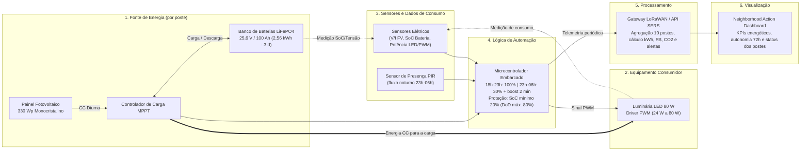

# Relatório Técnico — Neighborhood Action Dashboard (Módulo SERS)

> **Disciplina:** Soluções em Energias Renováveis e Sustentáveis (SERS)  
> **Curso:** Ciência da Computação — Turma **1CCPA** (FIAP)  
> **Desafio Integrador:** Global Solution 2026.2 (`CitizenTech`)

## Integrantes do Grupo

| Nome Completo | RM | Turma |
| :--- | :---: | :---: |
| **Thalles Passos da Cunha** | `574879` | 1CCPA |
| **Waldir Arthur Holanda de Sousa** | `576869` | 1CCPA |

---

## 1. Diagnóstico do Problema e Contextualização Comunitária

* **Espaço comunitário escolhido:** Praça comunitária de bairro urbano equipada com infraestrutura convencional de iluminação pública.
* **Problema energético identificado:** A praça opera com **10 postes antigos equipados com luminárias de vapor de sódio de 250 W** (potência nominal da lâmpada; despreza-se conservadoramente a perda adicional do reator eletromagnético), ligados ininterruptamente em 100% da potência durante **12 horas por noite** (18h00 às 06h00), sem qualquer controle de demanda ou medição automatizada.
* **Público beneficiado:** Moradores do entorno, frequentadores noturnos (idosos, famílias, praticantes de caminhada e usuários da quadra/ponto de ônibus adjacente) e a gestão pública municipal responsável pelo custeio da iluminação pública.
* **Condições de funcionamento da solução proposta:**
  * Operação noturna diária de **12 horas** (18h00 às 06h00), dividida em **horário de pico** (18h00–23h00, 5h em 100% da potência) e **horário de baixo fluxo** (23h00–06h00, 7h em modo dimerizado a 30% com elevação automática para 100% por 2 minutos via sensor PIR ao detectar movimento).
  * Captação solar diurna em região de referência do Sudeste brasileiro (~4,5 Horas de Sol Pleno — HSP — em média anual; ~3,5 HSP no inverno, segundo CRESESB/INPE), exigindo área livre de sombreamento severo sobre os módulos fotovoltaicos.
  * Armazenamento local em baterias de fosfato de ferro-lítio ($\text{LiFePO}_4$) dimensionado para **3 dias consecutivos de autonomia** em clima nublado/chuvoso, com telemetria integrada ao *Neighborhood Action Dashboard*.
* **Benefícios esperados para a comunidade:**
  1. **Segurança e qualidade visual:** Luminárias LED possuem Índice de Reprodução de Cor ($\text{IRC} > 70$) muito superior ao vapor de sódio ($\text{IRC} \approx 25$), facilitando a identificação de obstáculos e pessoas à noite; o sensor PIR garante retorno instantâneo a 100% quando há circulação na madrugada.
  2. **Resiliência energética:** Por operar de forma autônoma (*off-grid*), a praça permanece iluminada mesmo durante interrupções no fornecimento da concessionária elétrica.
  3. **Eficiência no orçamento público:** A eliminação da fatura mensal de R$ 765,00 (R$ 9.180,00/ano em uma única praça) libera recursos municipais que podem ser reinvestidos em manutenção urbana ou replicados em outras praças do bairro.
  4. **Redução da poluição luminosa e das emissões indiretas:** A dimerização durante a madrugada reduz o ofuscamento em residências vizinhas e o impacto sobre a fauna noturna, enquanto a substituição do consumo da rede evita emissões indiretas de $\text{CO}_2$ associadas ao despacho termelétrico do Sistema Interligado Nacional (SIN).

---

## 2. Análise do Consumo Energético Atual

Aplicou-se a equação fundamental de consumo elétrico prevista no escopo técnico:

$$
E = \frac{P \times t}{1000}
$$

onde $E$ é a energia consumida ($\text{kWh}$), $P$ é a potência elétrica ($\text{W}$) e $t$ é o tempo de funcionamento ($\text{h}$).

### Premissas e Fontes de Referência

* **Quantidade de postes:** $10$ unidades.
* **Potência nominal unitária (atual):** $250\text{ W}$ (potência instalada total $P_{\text{total}} = 10 \times 250\text{ W} = 2.500\text{ W} = 2,5\text{ kW}$).
* **Regime diário:** $12\text{ horas/dia}$ (18h00 às 06h00).
* **Períodos de referência:**
  * Mensal padrão: **$30\text{ dias}$**.
  * Anual comercial (base principal, consistente com a apresentação em vídeo): **$360\text{ dias}$** ($12 \times 30\text{ dias}$).
  * Sensibilidade anual calendário: **$365\text{ dias}$** (apresentada explicitamente nas tabelas abaixo).
* **Tarifa de energia elétrica:** R$ 0,85/kWh (premissa de referência baseada nas tarifas médias reguladas pela ANEEL, incluindo tributos).
* **Verificação reprodutível:** Todos os valores abaixo são gerados e validados pelo script [`src/calculos_sers.py`](../src/calculos_sers.py) e exportados para [`data/sers_dados_simulados.json`](../data/sers_dados_simulados.json).

### Resultados do Cenário Atual (Linha de Base)

| Métrica | Fórmula / Base | Resultado |
| :--- | :--- | ---: |
| **Consumo diário ($E_{\text{dia}}$)** | $(2.500\text{ W} \times 12\text{ h}) / 1000$ | **30,0 kWh/dia** |
| **Consumo mensal ($E_{\text{mês}}$, 30 d)** | $30\text{ kWh/dia} \times 30\text{ dias}$ | **900,0 kWh/mês** |
| **Consumo anual comercial (360 d)** | $900\text{ kWh/mês} \times 12\text{ meses}$ | **10.800,0 kWh/ano** |
| **Consumo anual civil (365 d — sensibilidade)** | $30\text{ kWh/dia} \times 365\text{ dias}$ | **10.950,0 kWh/ano** |
| **Custo mensal da fatura** | 900 kWh × R$ 0,85/kWh | **R$ 765,00/mês** |
| **Custo anual da fatura (360 d / 365 d)** | 10.800 ou 10.950 kWh × R$ 0,85/kWh | **R$ 9.180,00** / **R$ 9.307,50/ano** |

---

## 3. Comparação Fundamentada de Alternativas Energéticas

As duas alternativas foram avaliadas para a **mesma necessidade de iluminação pública** da praça ($10$ postes, $12\text{ h/noite}$, período comum de $30\text{ dias}$ e $12\text{ meses}$).

### Nota sobre Equivalência Luminosa (ABNT NBR 5101)

Uma lâmpada de vapor de sódio de $250\text{ W}$ gera cerca de $25.000\text{ lm}$ de forma omnidirecional, mas perde $30\%$ a $35\%$ no conjunto óptico do refletor ($\approx 16.000$ a $17.500\text{ lm}$ úteis no solo). Uma luminária LED pública direcional de $100\text{ W}$ ($\approx 140\text{ lm/W}$) ou de alta eficiência de $80\text{ W}$ ($\approx 155\text{ lm/W}$, $\approx 12.400\text{ lm}$ úteis com óptica assimétrica) é uma faixa usada em praças de pedestres (classes P3 e P4 da NBR 5101). A equivalência de iluminação é uma premissa deste estudo e depende da altura dos postes, do espaçamento e da fotometria da luminária, então precisa ser confirmada por um cálculo luminotécnico antes da implantação. Assume-se explicitamente o *trade-off* da Alternativa B na madrugada: durante os períodos sem presença, o fluxo cai para $30\%$ para economizar bateria, retornando imediatamente a $100\%$ quando o sensor PIR detecta movimento.

---

### Alternativa A — Retrofit com Luminárias LED Convencionais de 100 W (Ligadas à Rede)

* **Descrição:** Substituição das 10 luminárias de vapor de sódio ($250\text{ W}$) por luminárias LED de $100\text{ W}$ mantendo alimentação contínua da rede por $12\text{ h/dia}$ em potência máxima.
* **Consumo da rede:** $10 \times (100\text{ W} \times 12\text{ h}) / 1000 \times 30\text{ dias} = \mathbf{360\text{ kWh/mês}}$ (**economia de 60%** ou $540\text{ kWh/mês}$).
* **Custos estimados (ordem de grandeza fundamentada):**
  * **CAPEX:** 10 × (R$ 450 luminária LED pública 100 W + R$ 150 instalação) = **R$ 6.000,00** (reaproveita postes e cabeamento existentes).
  * **OPEX mensal:** fatura de energia de **R$ 306,00/mês** ($360 \times 0,85$) + reserva estimada de manutenção preventiva de ~R$ 30,00/mês.
  * **Retorno simples (*payback* sobre a fatura):** R$ 6.000 / (R$ 765 − R$ 306) = **13,1 meses**.
* **Viabilidade, benefícios e limitações:** Implantação rápida e menor desembolso inicial, porém mantém **100% de dependência da concessionária**, permanece sujeita a reajustes tarifários e apagões, e continua desperdiçando energia durante a madrugada vazia.

---

### Alternativa B (Solução Escolhida) — Luminárias Solares Fotovoltaicas (80 W) + Bateria $\text{LiFePO}_4$ + Dimerização PIR

* **Descrição:** Implantação de 10 conjuntos solares autônomos (*off-grid*) com módulo fotovoltaico, controlador MPPT, bateria $\text{LiFePO}_4$, luminária LED de $80\text{ W}$ com driver PWM e sensor infravermelho de presença (PIR).
* **Consumo da rede elétrica:** **$\mathbf{0\text{ kWh/mês}}$** ($100\%$ de substituição do consumo da concessionária).
* **Carga elétrica própria suprida pelo sistema solar (cálculo explícito):**
  * **Pico (18h00–23h00, $5\text{ h}$ a $80\text{ W}$):** $400\text{ Wh/dia/poste}$.
  * **Madrugada base (23h00–06h00, $7\text{ h}$ a $30\% = 24\text{ W}$):** $168\text{ Wh/dia/poste}$.
  * **Sem acionamentos PIR:** $400 + 168 = \mathbf{568\text{ Wh/dia/poste}}$ ($170,4\text{ kWh/mês}$ nos 10 postes).
  * **Operação realista (premissa: 15 acionamentos PIR/noite × 2 min = $0,5\text{ h}$ de acréscimo de $+56\text{ W}$):** $+28\text{ Wh/dia/poste} \rightarrow \mathbf{596\text{ Wh/dia/poste}}$ ($\mathbf{178,8\text{ kWh/mês}}$ nos 10 postes — redução de $80,1\%$ na própria demanda bruta em relação aos $900\text{ kWh/mês}$ do vapor de sódio).
  * **Pior caso (12h a 100%, sem dimerização):** $960\text{ Wh/dia/poste}$ ($288,0\text{ kWh/mês}$ nos 10 postes).
* **Dimensionamento técnico por poste (autonomia de 3 dias):**
  * Considerando eficiência de $90\%$ no controlador/driver, a demanda diária retirada da bateria é $596 / 0,90 \approx \mathbf{662,2\text{ Wh/dia}}$.
  * **Banco de baterias $\text{LiFePO}_4$:** para 3 dias de autonomia com profundidade máxima de descarga ($\text{DoD}$) de $80\%$, exige-se no mínimo $(662,2 \times 3) / 0,80 = \mathbf{2,48\text{ kWh/poste}}$. Especifica-se uma bateria $\text{LiFePO}_4$ de **$25,6\text{ V} / 100\text{ Ah}$ ($2,56\text{ kWh}$)**, resultando em **3,09 dias de autonomia real**.
  * **Módulo fotovoltaico:** considerando inverno no Sudeste ($\text{HSP} = 3,5\text{ h/dia}$, CRESESB/INPE) e taxa de desempenho ($\text{PR} = 0,75$), exige-se $662,2 / (3,5 \times 0,75) \approx 252,3\text{ Wp}$. Especifica-se **1 módulo monocristalino de $330\text{ Wp}$ por poste**, que gera em média **$1.113,8\text{ Wh/dia}$** ($4,5\text{ HSP}$) e **$866,2\text{ Wh/dia}$** no inverno, garantindo folga para recarga após sequências nubladas.
* **Custos estimados (CAPEX, OPEX e ciclo de vida):**
  * **Fatura elétrica mensal:** **R$ 0,00/mês**.
  * **Reserva de manutenção preventiva (OPEX não-nulo):** estimada em **~R$ 50,00/mês** (R$ 600/ano para limpeza semestral dos painéis e inspeção dos sensores PIR), além da **substituição planejada das baterias $\text{LiFePO}_4$ após 6 a 8 anos** (~2.500–3.000 ciclos).
  * **CAPEX e Payback:**
    * *Sistema especificado neste relatório, com autonomia de 3 dias* (módulo 330 Wp + banco dedicado 2,56 kWh $\text{LiFePO}_4$ ~R$ 3.200/poste): **R$ 32.000,00** $\rightarrow$ *payback* simples sobre a fatura de **41,8 meses** (ou **44,8 meses** descontando a reserva de manutenção de R$ 50/mês). Este é o valor de referência da proposta.
    * *Kit comercial compacto, citado só como comparação* (~R$ 2.000/poste aproveitando postes existentes, dispensando obras de valas): **R$ 20.000,00** $\rightarrow$ *payback* simples sobre a fatura de **26,1 meses** (ou **28,0 meses** descontando a reserva de manutenção de R$ 50/mês). Esse kit tem bateria menor e não garante os 3 dias de autonomia.
  * **Base dos valores:** os custos por poste são ordens de grandeza de mercado para módulo de 330 Wp, bateria LiFePO4 de 2,56 kWh, controlador MPPT, luminária LED de 80 W e instalação, e não um orçamento comercial. A troca das baterias depois de 6 a 8 anos não entra no payback simples.
* **Viabilidade, benefícios e limitações:** Não precisa de obra civil nem de ligação à rede, mas exige módulos sem sombra de árvores ou prédios. Benefícios: fatura zero, praça acesa durante apagões e menos desperdício na madrugada. Limitações: investimento inicial maior, troca das baterias em 6 a 8 anos e fluxo reduzido a 30% quando não há presença.

---

### Quadro Comparativo Resumido

| Critério | Cenário Atual (Vapor de Sódio 250 W) | Alternativa A (LED 100 W na Rede) | Alternativa B — Escolhida (Solar 80 W + $\text{LiFePO}_4$ + PIR) |
| :--- | :--- | :--- | :--- |
| **Fonte de Energia** | Rede elétrica (SIN) | Rede elétrica (SIN) | **100% Solar Fotovoltaica (Off-Grid)** |
| **Consumo da Rede (30 d)** | $900\text{ kWh/mês}$ | $360\text{ kWh/mês}$ ($-60\%$) | **$0\text{ kWh/mês}$ ($-100\%$ da rede)** |
| **Carga Própria Local (30 d)** | — | — | **$170,4\text{–}178,8\text{ kWh/mês}$** (suprida pelo sol) |
| **Fatura Mensal de Energia** | R$ 765,00/mês | R$ 306,00/mês | **R$ 0,00/mês** |
| **OPEX Manutenção (estimado)** | Troca frequente de lâmpadas/reatores | ~R$ 30/mês | ~R$ 50/mês + troca baterias em 6–8 anos |
| **CAPEX Estimado** | R$ 0 (existente) | ~R$ 6.000 | ~R$ 20.000 (kit integrado) a ~R$ 32.000 (banco 3 d) |
| **Payback Simples (fatura)** | — | **13,1 meses** | **41,8 meses** (sistema especificado) / 26,1 meses (kit compacto) |
| **Emissões Evitadas (MCTI 2025 / Seco)** | $0\text{ kg CO}_2\text{/ano}$ | $298,7$ / $550,8\text{ kg CO}_2\text{/ano}$ | **$497,9$ / $918,0\text{ kg CO}_2\text{/ano}$** |
| **Resiliência e Automação** | Nenhuma | Nenhuma | **Autônoma contra apagões + dimerização PIR** |
| **Impacto Ambiental (ciclo de vida)** | Alto (desperdício + mercúrio/sódio) | Médio (reduz consumo da rede) | **Baixo em operação**; exige logística reversa de baterias/painéis |

---

## 4. Diagrama Conceitual da Solução

O diagrama a seguir integra os seis blocos essenciais exigidos: **fonte de energia**, **equipamentos consumidores**, **sensores de presença e de consumo/energia**, **lógica de automação**, **processamento das informações** e **indicadores no dashboard**.

---

## 5. Indicadores de Eficiência e Sustentabilidade (Integração ao Dashboard)

Todos os indicadores abaixo são calculados de forma reprodutível em [`src/calculos_sers.py`](../src/calculos_sers.py) e exibidos interativamente no módulo [`dashboard/index.html`](../dashboard/index.html):

| Indicador | Valor Projetado (Alt B) | Unidade | Base de Cálculo / Premissa |
| :--- | :---: | :---: | :--- |
| **Consumo da Rede Elétrica** | **0** (vs. 900 atual) | $\text{kWh/mês}$ | Desconexão total da rede convencional ($100\%$ *off-grid*). |
| **Economia Energética da Rede** | **900** (**100%**) | $\text{kWh/mês}$ | $10.800\text{ kWh/ano}$ ($360\text{ d}$) ou $10.950\text{ kWh/ano}$ ($365\text{ d}$). |
| **Carga Local Solar Suprida** | **178,8** (170,4 sem PIR) | $\text{kWh/mês}$ | $596\text{ Wh/dia/poste} \times 10\text{ postes} \times 30\text{ dias}$. |
| **Redução na Fatura Elétrica** | **R$ 765,00** | reais/mês | 900 kWh × R$ 0,85/kWh (R$ 9.180,00/ano). |
| **Participação de Energia Renovável** | **100** | $\%$ | Suprimento integral por geração solar fotovoltaica local. |
| **Tempo de Operação Eficiente** | **7** | $\text{horas/dia}$ | Faixa da madrugada (23h00–06h00) em regime dimerizado ($30\%$). |
| **Emissões de $\text{CO}_2$ Evitadas** | **497,9** a **918,0** | $\text{kg CO}_2\text{/ano}$ | Ver análise de sensibilidade MCTI/SIRENE abaixo. |

### Análise de Sensibilidade — Emissões de $\text{CO}_2$ Evitadas (Fatores Oficiais do SIN — MCTI/SIRENE)

Os fatores publicados pelo MCTI para o SIN variam conforme a hidrologia e o despacho termelétrico de cada ano (e contemplam $\text{CO}_2$). Para transparência científica e consistência com a apresentação em vídeo, o dashboard permite alternar entre os fatores oficiais:

| Cenário / Referência SIN | Fator ($\text{tCO}_2/\text{MWh}$) | Alt A — 360 d ($\text{kg CO}_2/\text{ano}$) | Alt B — 360 d ($\text{kg CO}_2/\text{ano}$) | Alt B — 365 d ($\text{kg CO}_2/\text{ano}$) |
| :--- | :---: | :---: | :---: | :---: |
| **MCTI SIN 2025 (média anual oficial)** | `0,0461` | 298,7 | **497,9** | 504,8 |
| **MCTI SIN 2024 (média anual oficial)** | `0,0545` | 353,2 | **588,6** | 596,8 |
| **MCTI SIN 2023 (mínimo recente)** | `0,0385` | 249,5 | **415,8** | 421,6 |
| **Cenário seco ilustrativo (referência do vídeo)** | `0,0850` | 550,8 | **918,0** | 930,8 |
| **MCTI SIN 2021 (estresse hídrico severo)** | `0,1263` | 818,4 | **1.364,0** | 1.383,0 |

---

## 6. Limitações, Premissas e Responsabilidade Ambiental

1. **Caráter projetivo:** Todos os números de economia energética, redução financeira e emissões evitadas são **projeções condicionadas às premissas adotadas** (potência nominal, horas de uso, tarifa média de R$ 0,85/kWh, irradiação solar de referência e fatores do SIN), não configurando garantia contratual de desempenho em campo.
2. **Sazonalidade climática e sombreamento urbano:** A geração fotovoltaica depende da incidência solar livre de obstáculos. Na simulação de 72 horas (1 dia ensolarado + 2 dias nublados com 20%–25% de sol), o estado de carga (SoC) do banco de $2,56\text{ kWh}$ teve mínimo de **42,0%** (limite seguro: 20%). Contudo, copas de árvores podem degradar postes individuais — motivo pelo qual o dashboard inclui monitoramento por poste (ilustrado pelo alerta de atenção no poste `P-08`).
3. **Ciclo de vida e logística reversa:** Embora a operação seja livre de emissões diretas, a fabricação de módulos fotovoltaicos e baterias $\text{LiFePO}_4$ possui pegada ambiental incorporada. As baterias demandam substituição planejada em 6–8 anos e destinação adequada conforme a Política Nacional de Resíduos Sólidos (Lei nº 12.305/2010).
4. **Simulação em software:** Conforme previsto no enunciado de SERS, a integração ao *Neighborhood Action Dashboard* utiliza dados simulados e cálculos reprodutíveis em Python/JavaScript, sem construção física de protótipos.

---

## 7. Referências Técnicas

* **MCTI / SIRENE (Ministério da Ciência, Tecnologia e Inovação).** *Fatores de Emissão de CO₂ pela Geração de Energia Elétrica no Sistema Interligado Nacional (SIN) — Fator Médio para Inventários Corporativos (Séries 2021–2025).* Disponível em: `gov.br/mcti`.
* **ANEEL (Agência Nacional de Energia Elétrica).** *Tarifas Médias de Fornecimento de Energia Elétrica e Regras de Iluminação Pública (Classe B4a / Resolução Normativa nº 1.000/2021).* Disponível em: `gov.br/aneel`.
* **EPE (Empresa de Pesquisa Energética).** *Balanço Energético Nacional (BEN) — Matriz Elétrica Brasileira e Parâmetros de Consumo.* Disponível em: `epe.gov.br`.
* **CRESESB / CEPEL / INPE.** *Atlas Brasileiro de Energia Solar e Potencial Solar — Horas de Sol Pleno (HSP) na Região Sudeste.* Disponível em: `cresesb.cepel.br`.
* **ABNT NBR 5101.** *Iluminação Pública — Procedimento (requisitos de iluminância e uniformidade para vias e áreas de pedestres).*
